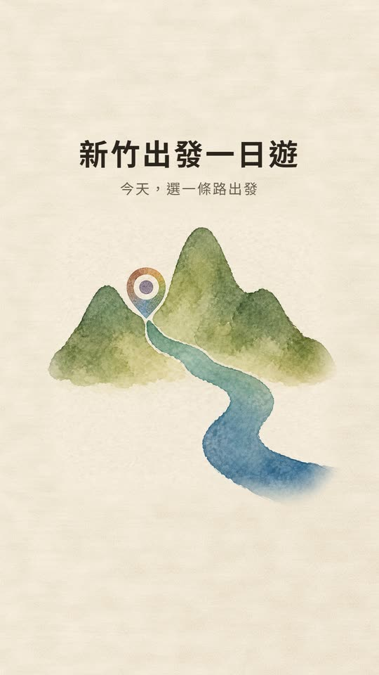

# 新竹出發一日遊

**從新竹出門，當天來回**　步道、老街、海邊、吃的，挑好直接開導航

👉 **https://tw101099.github.io/hsinchu-day-trips/**

點上圖看 26 秒介紹影片。

## 怎麼用

1. 打開網站，地圖上就是從新竹出發、一天來回得了的地方。按「篩選」可以照路段、主題、時間、費力、季節縮小範圍，例如只看「竹37｜北埔・五指山」這一條路上的點；想找特定的東西也可以直接搜尋。
2. 點一個地方，看介紹、開放時間和要注意的事，底下還列著車程 15 分鐘內、順路可以一起去的點。
3. 想去就按「＋」加進行程。到「行程」頁設出發時間、調每一站要停多久，會算出大概幾點回到新竹。
4. 要出門了，按「用 Google 地圖導航」。也可以「複製分享連結」，把排好的行程傳給一起去的人。

## 這個站有什麼

- 559 個地方，北到桃園、南到苗栗和台中海線，沿著 28 條路段分組。
- 八種主題：古蹟人文、水庫湖埤、海岸濕地、高山林道、近郊步道、吃的、咖啡茶館、老街聚落。
- 清單上的車程是用實際道路算好的估計；行程裡兩站之間算不到時，會退回估算並標「約」。車程不含塞車和找停車位。

## 加到手機主畫面

- iPhone／iPad（Safari）：按「分享」→「加入主畫面」。
- Android（Chrome）：選單 →「安裝應用程式」或「加到主畫面」。

加到主畫面之後，打開就像一個 App。沒有網路的時候，看過的頁面還打得開，但地圖底圖要有網路才會出來。

## 出發前

山區路況、林道封閉、園區開放時間和店家公休都會變動，出發前請以官方公告和店家粉專為準。這個網站只供排行程參考，不保證資訊正確或即時。

地圖底圖與圖磚來自 OpenStreetMap 貢獻者。

## 隱私

不用註冊、不用登入，沒有廣告。排好的行程只存在你自己的裝置上，不會上傳。
網站使用不依賴 Cookie 的流量統計服務，以了解整體造訪情況，不追蹤個人的使用紀錄。

## 授權

MIT License，見 [LICENSE](LICENSE)。
